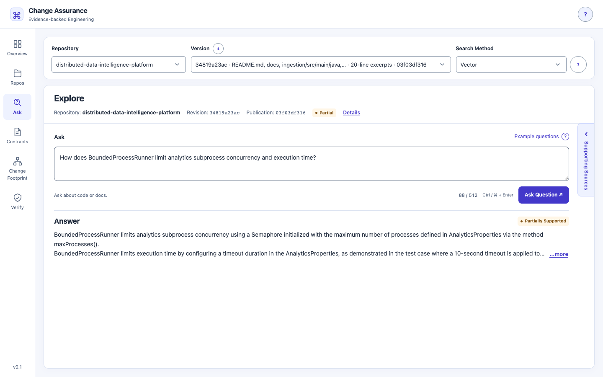
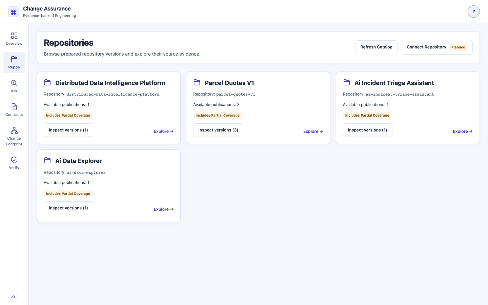
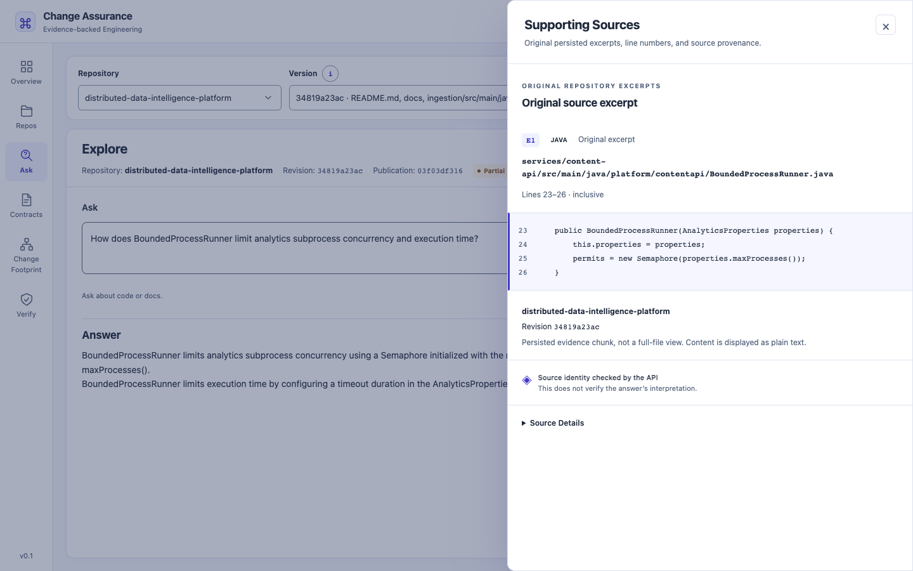
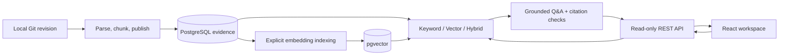

# Agentic Software Change Assurance Platform

**Understand a repository. Inspect the evidence. Make better-informed engineering decisions.**

Change Assurance turns questions about committed Java code and Markdown documentation
into answers with inspectable source excerpts, immutable Git provenance, and explicit
uncertainty. Repository Intelligence is the first implemented capability in a larger
vision for evidence-backed software change assessment.

**Upcoming release: v0.1.0 — Repository Intelligence Foundation.** The M1 implementation
and UI are complete; release publication remains a maintainer action. This repository
does not yet analyze pull requests, approve changes, or decide whether software is safe
to deploy.

[Product overview](docs/product-overview.md) · [Get started](docs/getting-started.md) ·
[90-second demo](docs/demo.md) · [Measured results](docs/releases/v0.1.0-results.md)

## The engineering problem

Understanding an unfamiliar codebase means connecting implementation, tests, and
architecture notes—often across several repositories. Keyword search finds names,
but not every question uses the vocabulary of the code. A fluent model answer is
also insufficient: reviewers need to know which revision it describes, where its
claims came from, and what evidence is missing.

The long-term goal is to connect that evidence to proposed changes, affected
interfaces, and verification needs. The current release addresses the prerequisite:
reliable repository selection, retrieval, and source inspection.

## What you can do today

- Browse prepared repositories and explicitly select an immutable publication.
  Versions retain their commit, scope, processing configuration, and coverage.
- Ask natural-language questions with **Keyword**, **Vector**, or **Hybrid** search.
- Read structured answers with claims, citations, and `SUPPORTED`,
  `PARTIALLY_SUPPORTED`, or `INSUFFICIENT_EVIDENCE` outcomes.
- Follow citations to the original persisted Java/Markdown excerpt, inclusive line
  numbers, Git revision, hashes, and parser provenance.
- Inspect uncertainty, omitted evidence, model metadata, and invocation diagnostics.
- Prepare evidence and embedding indexes through explicit local CLI workflows;
  evaluate retrieval and answers with versioned cases and reproducible reports.

**A valid citation establishes source identity, not factual correctness.** The model
can misinterpret correct evidence. Missing evidence does not prove a feature is absent.

## Application walkthrough

These are actual Chrome captures of the accepted UI and local data, not mockups.
The interface abbreviates the upcoming release as “v0.1”; no GitHub release is implied.



Ask questions about committed code; inspect the answer's status and remaining limitations.



Choose an explicit repository publication with its pinned revision and processing scope.



Inspect original cited Java evidence and its source coordinates.

See the [complete screenshot gallery and capture provenance](docs/assets/v0.1.0/README.md),
including Overview, Full Answer, and its uncertainty disclosures.

## How Repository Intelligence works

1. An operator publishes an explicit local Git revision. Only committed objects are
   read; staged, unstaged, and untracked edits are ignored.
2. Java/Markdown parsers produce bounded evidence chunks with original source
   coordinates. Unsupported files and incomplete processing remain visible.
3. PostgreSQL stores an immutable publication. Optional, separately generated Nomic
   embeddings are indexed by a versioned profile in pgvector.
4. A question retrieves evidence from the selected publication. Bounded context goes
   to the local answer model; the application validates returned citation identities.
5. The read-only API returns the answer, uncertainty, and diagnostics. React displays
   them and resolves citations through publication-scoped evidence endpoints.



One Java modular monolith owns ingestion, persistence, retrieval, and answering.
The frontend is a presentation layer, not a second retrieval pipeline. Write-enabled
CLI preparation is separate from the loopback-only HTTP process, which disables
migrations and CLI execution. See the [architecture](docs/architecture/overview.md)
and [decisions](docs/adr/README.md).

## Technology stack

| Area | Implemented technology |
| --- | --- |
| Backend | Java 21, Spring Boot 4.1.1, Spring AI 2.0.1, Maven Wrapper |
| Evidence | JavaParser, CommonMark, Spring JDBC, PostgreSQL 17, Flyway |
| Retrieval | PostgreSQL keyword search, exact pgvector cosine search, reciprocal-rank fusion |
| Local models | Ollama; `qwen3:4b-instruct` answers, `nomic-embed-text:v1.5` embeddings |
| Frontend | React, strict TypeScript, Vite, native fetch, Radix accessibility primitives |
| Verification | JUnit, Testcontainers, Vitest, React Testing Library, Python hygiene checks, GitHub Actions |

## Getting started

Use **JDK 21**, Git 2.48+, Docker with Compose, Ollama, Python 3.9+, and
**Node 24.19.0 / npm 11** ([pinned runtime](frontend/.nvmrc)). Maven 3.9.16 is downloaded
by the wrapper. No global Maven installation is required.

### First-time setup

Follow [first-time setup and CLI preparation](docs/getting-started.md) to configure
PostgreSQL and pgvector, prepare the required local models, initialize the application
database, and publish a compatible local Git repository. Generate embeddings when
using Vector or Hybrid, before starting the read-only API.

**Demonstration repository publications are not bundled or automatically seeded into a fresh database.**

### Already configured

For an already prepared database, with its credentials loaded privately and a
compatible stored embedding profile selected:

```sh
# API terminal; database and Ollama must already be running.
: "${EVIDENCE_DB_URL:?Load the existing JDBC URL}"
: "${EVIDENCE_DB_USER:?Load the existing database user}"
: "${EVIDENCE_DB_PASSWORD:?Load the existing database password privately}"
: "${INTELLIGENCE_API_EMBEDDING_PROFILE_ID:?Select the stored compatible profile}"
export INTELLIGENCE_API_BROWSER_ORIGIN=http://127.0.0.1:5173
./mvnw spring-boot:run -Dspring-boot.run.profiles=intelligence-api,embeddings
```

```sh
# Frontend terminal, using the pinned Node version.
npm ci --prefix frontend
npm run dev --prefix frontend
```

Open **http://127.0.0.1:5173/**. The browser origin must match the API configuration.

The maintainer's local demo contains `parcel-quotes-v1`, `ai-data-explorer`,
`ai-incident-triage-assistant`, and `distributed-data-intelligence-platform`.
Change Assurance self-ingestion is planned after M1.9c merges; it is not indexed.

## Questions to try

| Repository / perspective | Example question |
| --- | --- |
| DDIP / developer | How does BoundedProcessRunner limit analytics subprocess concurrency and execution time? |
| AI Data Explorer / reviewer | What approval and SQL checks are required before a query executes? |
| Incident Triage / architect | How are logs and runbooks bounded in the AI triage prompt? |
| Parcel Quotes / QA engineer | Which tests cover remote-destination pricing? |
| Any selected repository / product owner | What capabilities does this repository provide? |

These are questions, not promised answers. The Incident Triage experiment retrieved
documentation instead of the relevant Java implementation and did not explain its bounds.

## Evaluation: measured results and useful failures

| Evidence population | Recorded result | What it establishes |
| --- | --- | --- |
| Controlled Parcel Quotes keyword baseline, K=5 | Macro Recall@5 **0.5714**, MRR@5 **0.6369**; 15 queries, 14 with expected evidence | Lexical evidence retrieval on this small versioned corpus, not answer accuracy |
| Same baseline latency | Median **1.579 ms**, p95 **2.259 ms**, 150 samples | Historical local retrieval latency; excludes answer generation |
| Three real-repository publication experiments | AI Data Explorer **1,112/1,112**, Incident Triage **1,649/1,649**, DDIP **1,155/1,155** chunks indexed | Complete indexing of emitted chunks; all three publications retain `PARTIAL` coverage |
| One VECTOR question per real repository | All three returned `PARTIALLY_SUPPORTED`; **8/8** returned citations matched recorded source identity/excerpts | Functional evidence navigation; no aggregate semantic-correctness score |
| Fresh DDIP screenshot run | `PARTIALLY_SUPPORTED`, **12.991 s**, Java implementation and test citations | One additional live observation, not a benchmark |

The [committed keyword baseline](evaluation/retrieval/baseline-v1.json) and
[release results with source-report hashes](docs/releases/v0.1.0-results.md) provide
provenance and denominators. Controlled-corpus scores are **not** transferred to real
repositories. Historical live Q&A also confused cents with dollars despite valid
citations. M1.8 separates capture, deterministic grading, and attributed human review;
unreviewed answers receive no automatic semantic credit.

## Limitations and security boundary

- Source ingestion currently supports Java source files and Markdown documentation.
  Python, TypeScript, YAML, SQL, and other formats are not processed as implementation
  evidence. Java is not compiled and repository tests are not run.
- Scope exclusions, parser restrictions, chunk limits, and context budgets can omit
  relevant evidence. Complete indexing does not mean complete repository understanding.
- Local trusted-operator use only: loopback bindings, restricted Host/Origin, no
  authentication or RBAC. Do not expose the API or Vite server publicly.
- Repository content is untrusted data. The UI escapes source text; evidence lookup
  uses publication/chunk IDs, never browser-provided filesystem paths.
- No browser answer persistence, full-file browser, conversation history, or streaming.
- No PR change-impact analysis, contract compatibility validation, cross-service
  dependency reasoning, automated test execution, autonomous change approval,
  deployment decisions, or GitHub onboarding. Connection controls are disabled previews.

## Incremental roadmap

| Milestone | State | Direction |
| --- | --- | --- |
| M0 — Foundation | Complete | Build, CI, conventions, architecture decisions |
| M1 — Repository Intelligence | Implemented; upcoming v0.1.0 closeout | Publications, retrieval, cited answers, evaluation, local API/UI |
| M2 — Contract Intelligence | Planned | Contract and dependency evidence |
| M3 — Change Footprint | Planned | Change-Impact Analysis across affected components and interfaces |
| M4 — Assisted Verification | Planned | Controlled investigation and verification guidance; engineering milestone: Controlled Agent |
| M5 — Production AI Engineering | Planned | Broader observability, security, cost, and limited hosted validation |

See the [roadmap](docs/roadmap.md). The product name expresses the long-term vision;
agent orchestration is not part of this release.

## Documentation map

| Start here | Engineering detail |
| --- | --- |
| [Product overview](docs/product-overview.md) | [Architecture and boundaries](docs/architecture/overview.md) |
| [Local setup](docs/getting-started.md) | [Ingestion](docs/architecture/git-snapshot-ingestion.md), [processing](docs/architecture/artifact-processing.md), [indexing](docs/architecture/embedding-indexing.md) |
| [60–90 second demo](docs/demo.md) | [REST API](docs/architecture/repository-intelligence-api.md), [React workspace](docs/architecture/repository-intelligence-workspace.md) |
| [Release results](docs/releases/v0.1.0-results.md) | [Evaluation definitions](evaluation/README.md), [development conventions](docs/development.md), [ADRs](docs/adr/README.md) |

## Development and testing

```sh
python3 scripts/check_repository.py
npm ci --prefix frontend
npm run typecheck --prefix frontend
npm test --prefix frontend
npm run build --prefix frontend
./mvnw clean verify
git diff --check
git diff --cached --check
```

Full Maven verification requires Docker for disposable PostgreSQL tests. Mandatory
checks use deterministic model doubles, not live Ollama. `./mvnw test` is database-independent;
plain `./mvnw spring-boot:run` starts only the default health-capable application,
not the Repository Intelligence API. The [CI workflow](.github/workflows/ci.yml)
uses the pinned frontend runtime and Java 21. Local verification is not a hosted CI result.

The repository checker lints Markdown whitespace/fences, validates inline relative
links and image targets, checks Git hygiene, and validates evaluation fixtures. It
is not a complete Markdown linter, external-link checker, or secret scanner.

## AI Assistance & Development Transparency

This project is independently developed and maintained with assistance from
OpenAI's ChatGPT and Codex. ChatGPT supports technical research, architecture,
trade-off analysis, planning, documentation, and engineering guidance. Codex assists
with implementation, refactoring, tests, and code review.

AI serves as an engineering assistant, not an autonomous decision-maker. All
architectural decisions, implementation choices, reviews, testing, and final approvals
remain the project maintainer's responsibility. AI-generated contributions receive
the same engineering standards, validation, and review as manually written code.

This is an independent initiative, not affiliated with, sponsored by, or endorsed by OpenAI.

## License

Licensed under the [Apache License 2.0](LICENSE).
