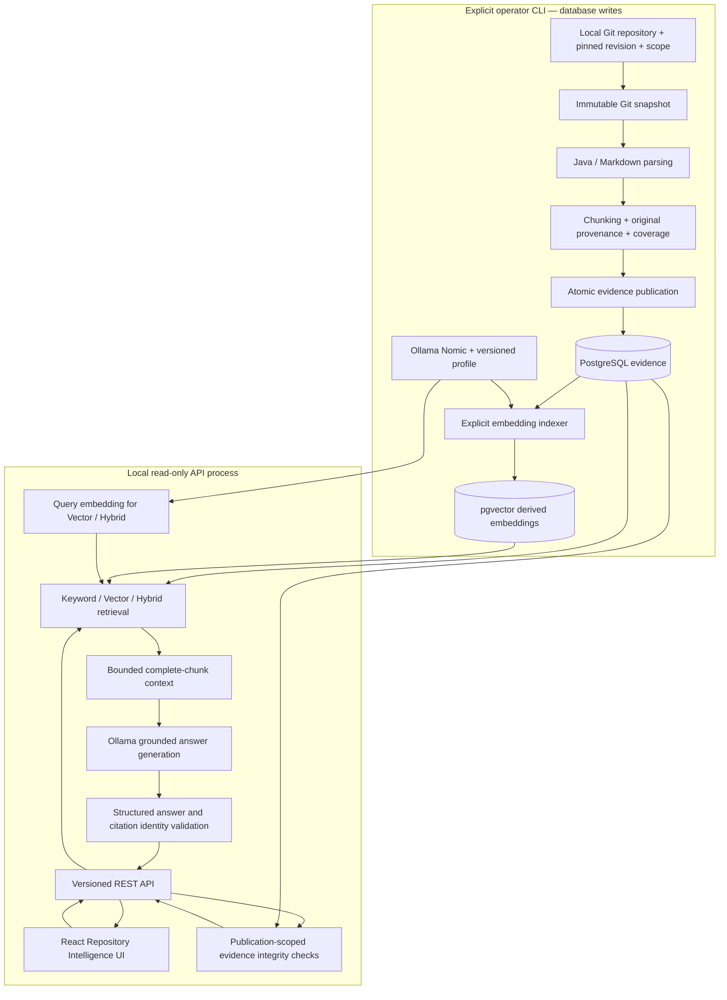

# Architecture overview

## Implemented M1 scope

**Upcoming v0.1.0 — Repository Intelligence Foundation** is a Java modular monolith
with a separate React presentation layer. It reads committed local Git evidence,
publishes immutable snapshots, retrieves relevant chunks, and produces cited answers
with explicit uncertainty. Contract reasoning, diff-driven change assessment, agents,
and deployment decisions remain planned. See the [product overview](../product-overview.md).

## Evidence and request flow

Query embedding and answer inference happen on demand; the API does not persist
new embeddings, publications, or conversations. Its controller delegates to existing
application services, capturing retrieval and diagnostics from the same answer run.
There is no second frontend RAG pipeline or automatic strategy fallback.

## Distinct contracts

| Concept | Meaning | What it does not establish |
| --- | --- | --- |
| Snapshot | Repository ID, resolved Git commit, scope, and ingestion policy | Current HEAD or uncommitted worktree content |
| Publication | Immutable snapshot plus processing configuration/derivation, artifacts, ordered chunks, and coverage | Complete repository understanding |
| Processing coverage | Discovered, ingested, excluded, unsupported, parsed, and failed outcomes; COMPLETE/PARTIAL/FAILED | Success of an embedding job or factual correctness |
| Embedding index | Derived vectors keyed by snapshot/chunk/profile, with completion checked against publication membership | Coverage of unsupported or omitted files |
| Retrieval | Ranked evidence from one explicit publication using Keyword, Vector, or Hybrid | Calibrated answer confidence or semantic correctness |
| Answer generation | Structured model response over bounded selected chunks, with claims and uncertainty | An independently verified conclusion |
| Citation validation | Returned citation matches an allowed evidence identity; evidence resolution also checks persisted integrity | Semantic entailment of a claim or proof of complete behavior |

Source coordinates refer to the original committed excerpt. Source/content hashes,
Git blob identity, parser metadata, and chunking configuration remain available.
A publication can remain PARTIAL while its emitted chunks are completely indexed.

## Packages and reusable boundaries

| Boundary | Responsibility | Detail |
| --- | --- | --- |
| `ingestion` | Read committed Git objects, apply scope/resource policy, retain provenance and exclusions | [Ingestion](git-snapshot-ingestion.md) |
| `processing` | JavaParser/CommonMark parsing and deterministic chunking | [Processing](artifact-processing.md) |
| `persistence` | Atomic immutable publication, JDBC reads, integrity verification | [Persistence](evidence-persistence.md) |
| `embedding` | Nomic profile/digest validation and explicit derived indexing | [Indexing](embedding-indexing.md) |
| `retrieval` | Publication-scoped keyword, exact vector, and reciprocal-rank fusion | [Keyword](keyword-retrieval.md), [Vector](vector-retrieval.md), [Hybrid](hybrid-retrieval.md) |
| `qa` | Context selection, model gateway, structured answer/citation validation | [Grounded Q&A](grounded-question-answering.md) |
| `evaluation` | Same-execution capture, deterministic grading, offline human reviews and reporting | [Retrieval](retrieval-evaluation.md), [answers](grounded-answer-evaluation.md), [reports](evaluation-reporting.md) |
| HTTP adapter | Five explicit versioned DTO endpoints; safe errors and local access restrictions | [API](repository-intelligence-api.md) |
| `frontend` | Catalog, explicit selection, questions, answer/source dialogs, Help, and planned previews | [Workspace](repository-intelligence-workspace.md) |

## Write-enabled preparation versus read-only use

Default Spring Boot startup exposes health and requires no database or model.
The `persistence` profile enables PostgreSQL and Flyway. Explicit CLI commands under
`persistence,qa` publish evidence; `persistence,embeddings` indexes a selected publication.
These are deliberate operator actions, not browser features.

The `intelligence-api` profile groups the existing persistence and Q&A configuration
but disables Flyway and SQL initialization, rejects CLI execution, binds to loopback,
and configures read-only database connections. Adding `embeddings` enables the existing
model integration for configured Vector/Hybrid requests. Model calls do not hold a
transaction over the entire answer operation.

This is a trusted local boundary: configured database publications are visible to the
operator; no authentication or RBAC is implemented. Read-only application behavior
is not protection against a privileged database administrator. Evidence is immutable
by application contract, not tamper-proof against arbitrary privileged SQL.

The Vite development proxy preserves browser Origin; backend Host/Origin checks stay
active. Source content, Markdown, and model output are escaped text. Citations resolve
by publication/chunk identities, never browser-supplied paths or line coordinates.
No repository scripts, tests, or HTML execute through source inspection.

## Design decisions and tradeoffs

- [ADR-0001](../adr/0001-modular-monolith.md): one deployable backend; domain packages
  provide cohesive boundaries without speculative microservices.
- [ADR-0002](../adr/0002-deterministic-analysis-before-ai-interpretation.md): deterministic
  facts and identity checks precede model interpretation; neither is an assurance guarantee.
- [ADR-0003](../adr/0003-evidence-provenance-and-reproducible-evaluation.md): provenance
  and versioned evaluation are first-class. Human semantic review remains separate.
- [ADR-0004](../adr/0004-atomic-evidence-publications.md): atomic immutable publications
  preserve coverage and reject identity conflicts; scope-specific storage duplicates some evidence.
- [ADR-0005](../adr/0005-versioned-derived-embedding-indexes.md): embeddings are replaceable
  derived indexes; per-chunk progress enables explicit recovery without rewriting source evidence.

Exact vector search and bounded full-publication reads favor inspectability at current
local scale. They are not evidence of large-scale performance. The current 768-dimension
schema, Java/Markdown support, local models, and fixed resource budgets are deliberate
limits, not a generic ingestion or multi-tenant production platform.

## Evaluation and release state

M1.8 captures requested/effective configuration, immutable identities, rankings,
context omissions, model/prompt metadata, and available timing/token counts. Offline
reports retain explicit review selection and denominators. No review means
NOT_REVIEWED, not correct. The [release results](../releases/v0.1.0-results.md) separate
controlled retrieval benchmarks from sparse real-repository experiments.

M1 functionality and the frozen UI are implemented; v0.1.0 is upcoming until the
maintainer tags/publishes it. The [roadmap](../roadmap.md) preserves the longer-term
contract, change-impact, controlled-agent, and production-engineering direction.
