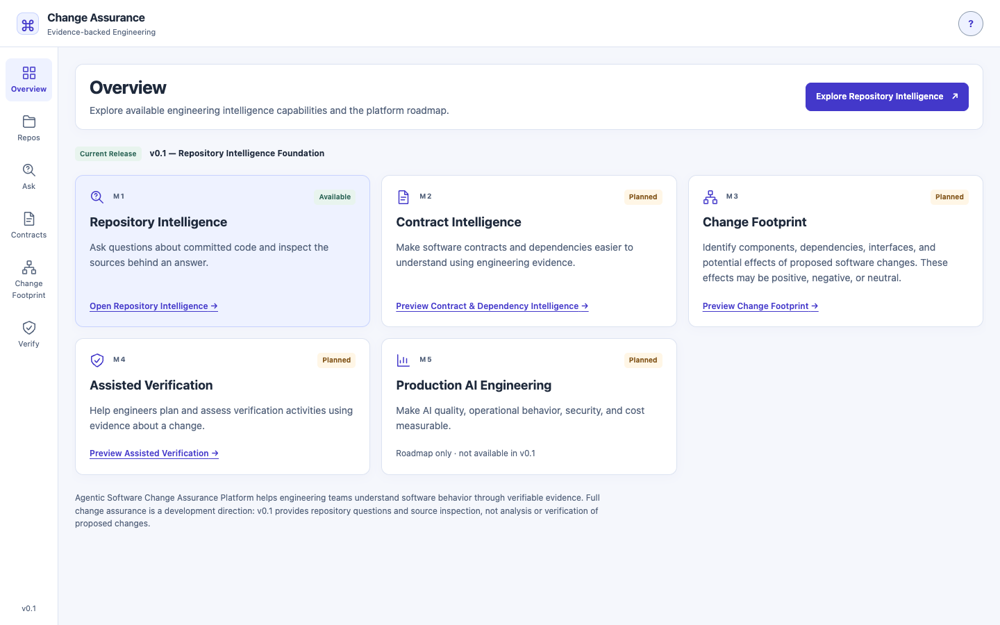
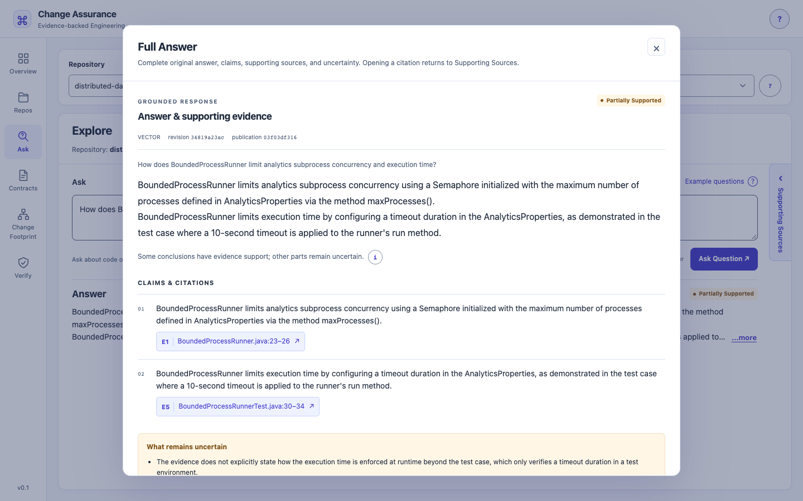
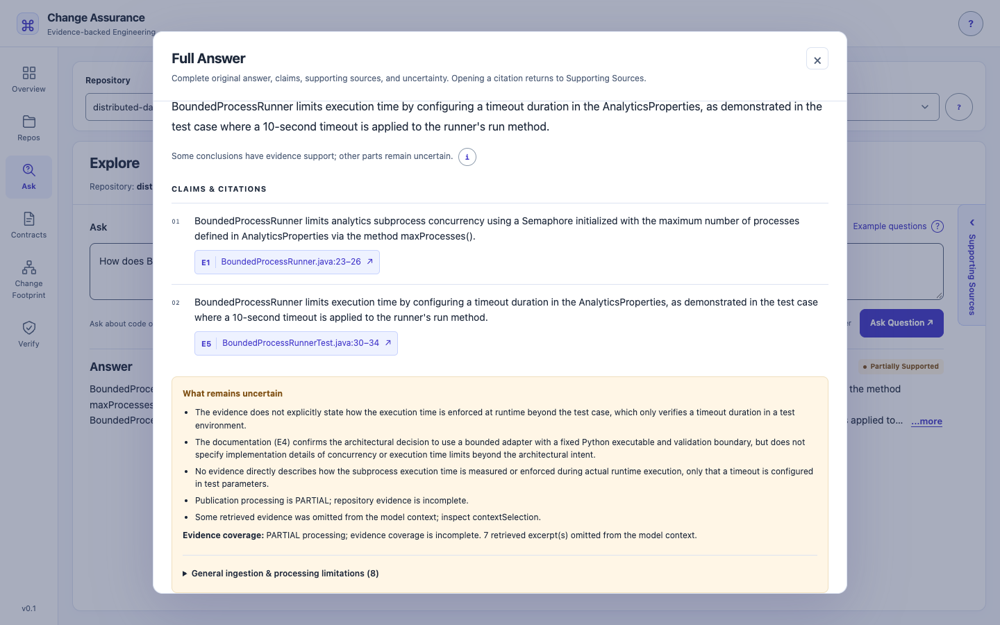
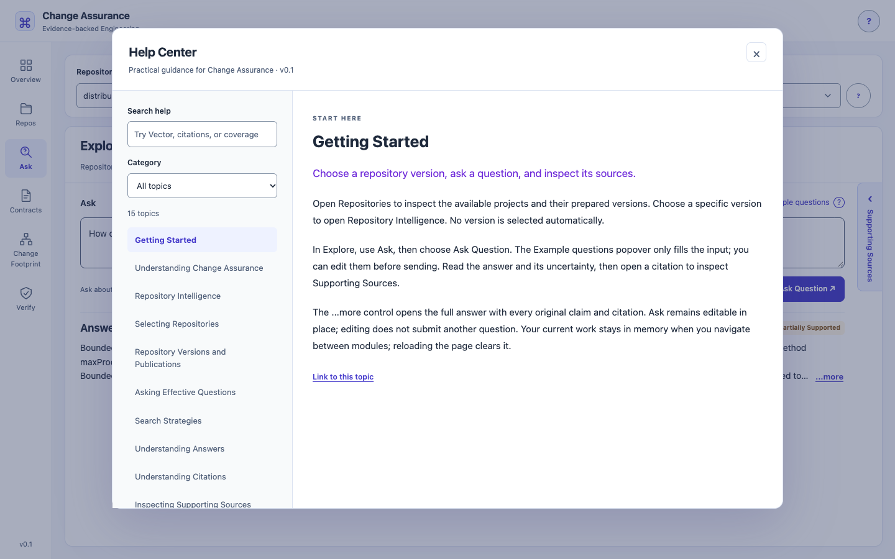

# v0.1.0 release screenshots

Actual installed Chrome **155.0.8059.85** captures, **2026-10-19**, all **1440×900**
CSS pixels at device scale 1. These show the frozen white/indigo UI and real local
publications. No API responses, answers, citation keys, or source content were mocked.
Screenshots retain the complete viewport; dialogs naturally scroll rather than exposing
all content at once. There is no browser chrome, developer tooling, credential, or
absolute local filesystem path in the selected images.

The screenshots total approximately **1.01 MiB** as lossless PNGs; no image tooling or
frontend dependency was added. [manifest.json](manifest.json) records exact dimensions,
byte sizes, capture time, and hashes. Temporary scripts, raw response bundles, and
rejected captures remain outside Git. The UI's “v0.1” label abbreviates the upcoming
**v0.1.0 — Repository Intelligence Foundation**; it does not establish a published release.

The DDIP response came from exactly one live VECTOR request. It returned
`PARTIALLY_SUPPORTED` in 12,991 ms; the screenshot run is distinct from the prior
11,101 ms experiment. See the [results record](../../releases/v0.1.0-results.md) and
[selected response/provenance](../../releases/v0.1.0-evidence.json).

## Overview

## Prepared repositories

## Live question and answer

## Full Answer

## Uncertainty remains visible

## Original Java evidence

The actual constructor excerpt matched the pinned Git source, original line terminators,
source/content hashes, and Git blob ID. This verifies source identity and excerpt
fidelity, not the full answer's factual correctness.

## Global Help

