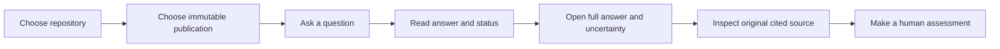

# Product overview

**v0.1.0 — Repository Intelligence Foundation** is the upcoming first release of
Change Assurance. Its purpose today is to help people understand a selected
repository using source evidence. The larger change-assessment platform remains an
incremental roadmap, not an implemented agentic execution system.

## Who it helps

| Stakeholder | A useful starting question | What to inspect afterward |
| --- | --- | --- |
| Product owner or engineering manager | What capabilities does this repository provide? | Whether the answer describes implementation or only documentation |
| Product manager | Does this application support wildcard searches? | Whether cited evidence demonstrates the behavior or leaves it uncertain |
| Engineering manager or product owner | Which product fields are stored and exposed through the API? | Whether evidence covers both stored fields and API responses |
| Developer | Where is shipping cost calculated? | The cited method and its original revision |
| QA engineer | Which tests cover remote-destination pricing? | Test source and assertions; the platform does not execute tests |
| Architect or system engineer | How does input validation connect to pricing? | Whether selected evidence actually connects both stages |
| Reviewer | What approval and SQL checks are required before a query executes? | Claims, supporting excerpts, and missing validation details |

Questions are interpreted against the selected evidence. The application does not
promise that a requested feature, behavior, or supporting test exists.

Stakeholder categories illustrate potential usage scenarios, not implemented authorization
roles or access permissions.

## The evidence workflow

A **repository** is the source-code project. A **publication** is its processed,
immutable snapshot: a particular Git commit, selected paths, parser derivation,
chunking configuration, and recorded coverage. Two publications can share the same
commit but cover different files or use different processing settings. Ordering is
not recency; selection never silently substitutes HEAD or a newer version.

The Repositories dashboard groups existing publications and lets you inspect versions.
Explore requires an explicit version before enabling Ask. The version Details dialog
retains full provenance and coverage. Repositories are currently prepared through a
trusted local CLI; Connect Repository is only a disabled future-feature preview.

## Search without assuming the answer

- **Keyword** finds matching words and technical terms. It is the server default.
- **Vector** finds semantically similar evidence using the configured embedding profile.
- **Hybrid** combines keyword and meaning-based rankings.

No strategy is universally best. Choosing Vector or Hybrid requires a compatible,
complete index for that publication; a configured strategy is not proof of runtime
readiness. Model, database, and index failures remain operational errors, not
insufficient-evidence answers. Requests are not automatically retried or rerouted.

The backend chooses bounded evidence and asks the local answer model to use it.
The UI displays the original answer; its compact preview is visually clamped, not
summarized by another model. **...more** opens the complete response, claims,
citations, uncertainties, and technical diagnostics.

## What the answer status means

| Status | Interpretation |
| --- | --- |
| `SUPPORTED` | The application reports support from selected evidence; it is not an independent factual-verification verdict. |
| `PARTIALLY_SUPPORTED` | Some conclusions have evidence support; parts of the question remain uncertain or incomplete. |
| `INSUFFICIENT_EVIDENCE` | The selected evidence cannot answer the question adequately; this does not establish repository-wide absence. |

A returned citation maps to a chunk within the selected publication. Clicking it opens
Supporting Sources with the original persisted excerpt, inclusive line numbers,
relative source path, and Git revision. Additional source hashes and parser metadata
are available on demand. This is an evidence excerpt viewer, not a full-file browser.

The application checks citation identities and persisted integrity. It does not
independently establish that the model interpreted the excerpt correctly, that a
claim follows from it, or that omitted evidence would not change the answer.

## Why an answer may be incomplete

Only Java and Markdown are processed. A publication can also intentionally exclude
paths. Parser restrictions, resource limits, or bounded context can omit useful
information. Even a complete embedding index covers only the emitted chunks.
Documentation may rank above implementation. Model answers may introduce mistakes:
the controlled corpus exposed a cents-to-dollars error despite a correct citation.

In the DDIP demo, Java constructor and test evidence were retrieved, but the answer
still qualified its description of runtime timeout enforcement. Incident Triage's
bounded-prompt question retrieved documentation rather than the relevant Java class.
These are useful limitations to inspect, not failures to hide. See the
[recorded results](releases/v0.1.0-results.md).

## Implemented versus planned

Repository Intelligence, source inspection, explicit uncertainty, reproducible
evaluation, and the local read-only API/UI are implemented. Contract Intelligence
(M2), Change Footprint (M3), Assisted Verification (M4), and Production AI Engineering
(M5) remain planned. There is no automated PR analysis, contract compatibility
validation, cross-service reasoning, repository test execution, change approval,
deployment decision, or GitHub onboarding.

The application is a trusted local demonstration, not a publicly accessible service.
Authentication and RBAC are not implemented; enterprise access-aware retrieval remains
planned. All publications in its configured database are visible to the trusted local
operator. Loopback and Origin/Host restrictions are not a replacement for authentication or enterprise
authorization. See [setup](getting-started.md), the [demo](demo.md), and
[architecture](architecture/overview.md) for the operating boundaries.
